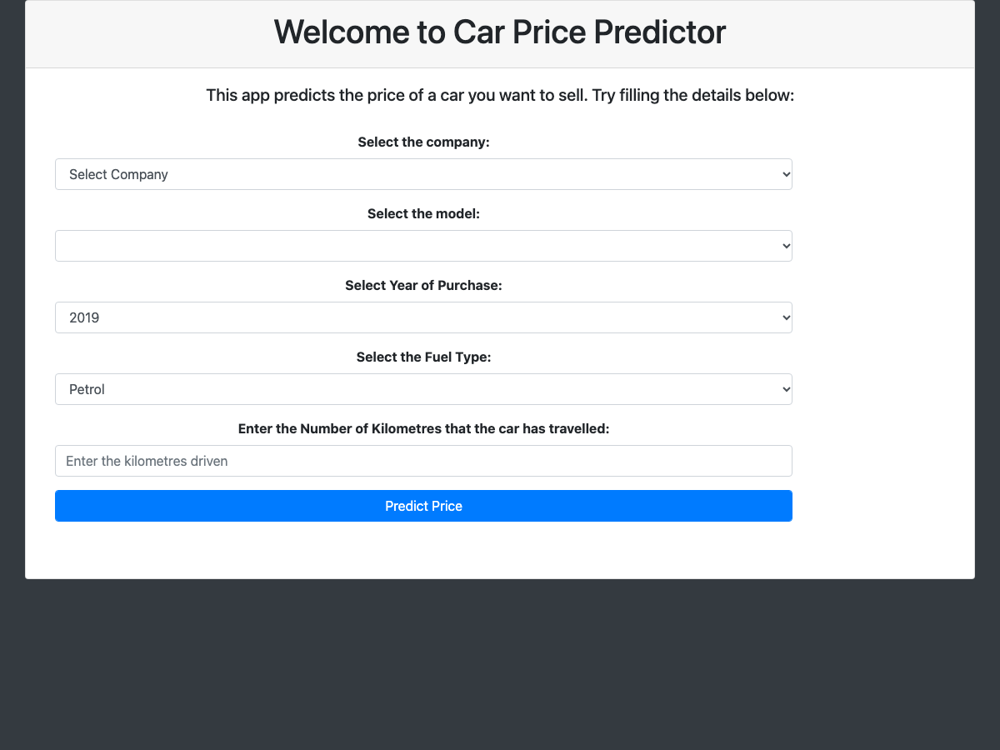
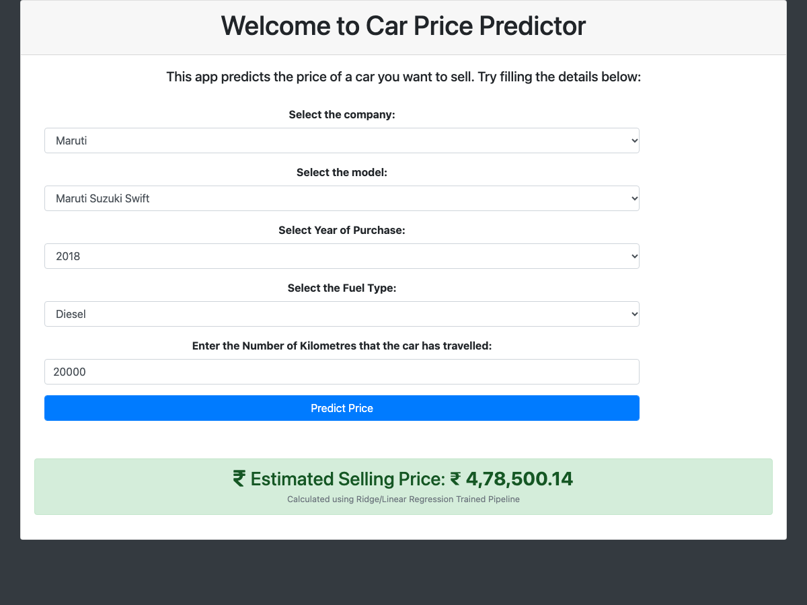
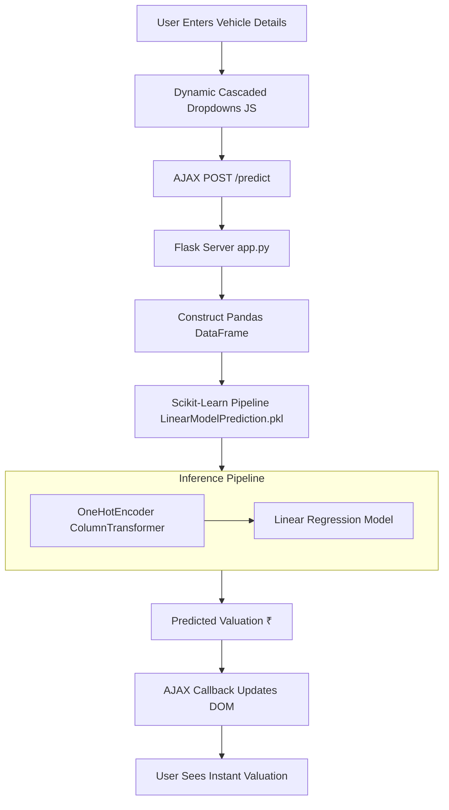

# 🚗 Car Price Predictor

[](https://www.python.org/)
[](https://flask.palletsprojects.com/)
[](https://scikit-learn.org/)
[](https://getbootstrap.com/)
[](https://opensource.org/licenses/MIT)

An end-to-end Machine Learning web application designed to predict the resale market valuation of pre-owned cars in the Indian automotive market. Trained on real-world scraped marketplace data from Quikr, the system couples a **Scikit-Learn Pipeline** with a responsive **Flask** web client for instant, real-time price estimation.

---

## 📌 Table of Contents
- [Project Overview](#-project-overview)
- [UI Screenshots](#-ui-screenshots)
- [How Things Work (System Architecture)](#-how-things-work-system-architecture)
- [Data Cleaning & Engineering Pipeline](#-data-cleaning--engineering-pipeline)
- [Model Architecture & Training](#-model-architecture--training)
- [Tech Stack](#-tech-stack)
- [Directory Structure](#-directory-structure)
- [Installation & Quickstart](#-installation--quickstart)
- [API Reference](#-api-reference)
- [Key Insights & Future Enhancements](#-key-insights--future-enhancements)

---

## 🔍 Project Overview

Accurately appraising a used car requires evaluating multiple interacting variables: manufacturer brand equity, specific model trim, manufacturing/registration year (depreciation), total kilometers accumulated (mechanical wear), and fuel powertrain economics.

This application provides:
1. **Interactive Frontend:** A clean, dark-themed responsive UI with dynamic cascading dropdowns (models auto-filtered based on selected company).
2. **Asynchronous Prediction:** AJAX-driven predictions with zero page reloads.
3. **Robust Scikit-Learn Pipeline:** Categorical encoding via `OneHotEncoder` bundled directly into a linear inference pipeline, eliminating train-serve feature skew.

---

## 🖼️ UI Screenshots

### 1. Application Dashboard (Input Form)
Clean form interface allowing users to select the car company, dynamically filtered model name, purchase year, fuel type, and kilometers driven:



---

### 2. Prediction Output
Asynchronous valuation display calculating the estimated market resale price in Indian Rupees (₹):



---

## ⚙️ How Things Work (System Architecture)

The system follows a modern decoupled client-server inference architecture:



### Detailed Execution Flow:
1. **Client Interaction:**
   - The user selects a vehicle manufacturer (e.g., *Maruti*, *Hyundai*, *Honda*).
   - An `onchange` event triggers `load_car_models()`, which instantly parses the Jinja2 dataset models and populates only those cars belonging to the selected manufacturer.
2. **Asynchronous Dispatch:**
   - On clicking **"Predict Price"**, `send_data()` traps default form submission, packages the input fields into a `FormData` object, and issues an asynchronous `POST` request to `/predict`.
3. **Backend Ingestion & Inference:**
   - Flask unpacks `company`, `car_models`, `year`, `fuel_type`, and `kilo_driven`.
   - The inputs are reshaped into a single-row Pandas DataFrame matching the exact schema expected by the preprocessor:
     `['name', 'company', 'year', 'kms_driven', 'fuel_type']`.
   - The serialized pipeline (`LinearModelPrediction.pkl`) executes the `OneHotEncoder` categorical transformation and passes numerical features directly to the `LinearRegression` weights vector.
4. **Result Rendering:**
   - The computed continuous scalar is rounded to two decimal places and returned via HTTP 200.
   - The AJAX listener intercepts the response and immediately updates the `#prediction` element without disrupting browser state.

---

## 🧹 Data Cleaning & Engineering Pipeline

The original dataset (`quikr_car.csv`) contained messy, unstructured web-scraped entries that required systematic feature engineering in `car price prediction.ipynb`:

| Feature | Raw Problem Identified | Engineering & Cleaning Strategy |
| :--- | :--- | :--- |
| **`year`** | Contained non-numeric text strings and junk rows. | Filtered using `.str.isnumeric()` and cast to `int32`. |
| **`Price`** | Included non-monetary strings (`"Ask For Price"`) and formatted commas (`"1,00,000"`). | Filtered non-prices, removed commas with `.str.replace(',', '')`, and cast to `int32`. |
| **Outliers** | Extreme luxury car outlier at ₹3.1 Crore ($>60,00,000$) skewing the linear hyperplane. | Trimmed to `df['Price'] < 6000000` to optimize general consumer vehicle pricing. |
| **`kms_driven`** | Contained text suffixes (`"45,000 kms"`) and strings (`"Petrol"`). | Split strings by space, extracted token 0, cleaned commas, filtered numeric, and converted to integer. |
| **`fuel_type`** | Contained `NaN` missing values. | Filtered out rows with `~df['fuel_type'].isna()`. |
| **`name`** | Full car model descriptions had 4–8 words including trims and variants (e.g. *"Maruti Suzuki Swift Dzire VXi 1.2 BS IV"*). | Extracted first 3 words using `.str.split(' ').str.slice(0,3).str.join(' ')` to prevent extreme categorical sparsity. |

Cleaned data was exported to `cleaned car data.csv` with **815 high-quality records**.

---

## 🧠 Model Architecture & Training

### 1. Feature Representation
- **Categorical Columns:** `name` (brand + model), `company`, `fuel_type`
- **Numerical Columns:** `year`, `kms_driven`
- **Target Variable:** `Price` (INR ₹)

### 2. Preprocessor & Pipeline
```python
from sklearn.compose import make_column_transformer
from sklearn.pipeline import make_pipeline
from sklearn.preprocessing import OneHotEncoder
from sklearn.linear_model import LinearRegression

# Column transformer ensures reproducible one-hot vectors across all categories
column_trans = make_column_transformer(
    (OneHotEncoder(categories=encoder.categories_), ['name', 'company', 'fuel_type']),
    remainder='passthrough'
)

# Unified Pipeline
pipe = make_pipeline(column_trans, LinearRegression())
```

### 3. Hyper-seed Split Optimization
Because used car datasets contain niche luxury and commuter segments, random train-test partitioning can introduce significant sample variance.
- Tested **1,000 different random train-test seeds** (`random_state=0..999`) with an 80/20 train-test ratio.
- Optimal split discovered at `random_state=433`, yielding an **$R^2$ score of ~0.846 (84.6%)**:

$$\text{Optimal Evaluation: } R^2 \approx 0.8457$$

The finalized trained pipeline was serialized to disk using `pickle` as `LinearModelPrediction.pkl`.

---

## 💻 Tech Stack

- **Machine Learning & Data Science:**
  - [Python 3](https://www.python.org/)
  - [Scikit-Learn](https://scikit-learn.org/) (Pipeline, ColumnTransformer, OneHotEncoder, LinearRegression)
  - [Pandas](https://pandas.pydata.org/) (Data manipulation & cleaning)
  - [NumPy](https://numpy.org/) (Vector operations)
- **Web Backend:**
  - [Flask](https://flask.palletsprojects.com/) (RESTful routing & Jinja2 templating)
  - [Flask-CORS](https://flask-cors.readthedocs.io/) (Cross-Origin Resource Sharing)
- **Frontend:**
  - [HTML5 / CSS3](https://developer.mozilla.org/)
  - [Bootstrap 4.5](https://getbootstrap.com/)
  - [JavaScript (ES6) & AJAX](https://developer.mozilla.org/en-US/docs/Web/Guide/AJAX)

---

## 📁 Directory Structure

```text
Car price prediction/
├── assets/                          # Static UI screenshots and visual assets
│   ├── ui_home.png                  # Screenshot of the clean input form
│   └── ui_prediction.png            # Screenshot showing dynamic prediction result
├── templates/
│   └── index.html                   # Interactive Jinja2 web template with dynamic JS
├── static/
│   └── css/
│       └── style.css                # Custom application styles
├── app.py                           # Flask backend serving API routes and UI
├── car price prediction.ipynb       # Jupyter notebook with EDA, cleaning, and modeling
├── cleaned car data.csv             # Structured, cleaned dataset (815 rows)
├── quikr_car.csv                    # Raw scraped Quikr car dataset
├── LinearModelPrediction.pkl         # Serialized end-to-end Scikit-Learn pipeline
└── README.md                        # Project documentation
```

---

## 🚀 Installation & Quickstart

### 1. Clone the Repository
```bash
git clone https://github.com/dhruv/Machine-learning-Projects.git
cd "Machine-learning-Projects/Car price prediction"
```

### 2. Set Up a Virtual Environment
```bash
# macOS/Linux
python3 -m venv venv
source venv/bin/activate

# Windows
python -m venv venv
venv\Scripts\activate
```

### 3. Install Dependencies
```bash
pip install flask flask-cors pandas numpy scikit-learn
```

### 4. Launch the Application
```bash
python app.py
```

Open your browser and navigate to:
```text
http://127.0.0.1:5000/
```

---

## 📡 API Reference

### `POST /predict`
Submits vehicle parameters and returns the estimated market price.

#### Request Parameters (Form-Data):
| Field | Type | Description | Example |
| :--- | :--- | :--- | :--- |
| `company` | `string` | Car manufacturer name | `"Maruti"` |
| `car_models` | `string` | Specific 3-token model name | `"Maruti Suzuki Swift"` |
| `year` | `integer` | Manufacturing / Purchase year | `2018` |
| `fuel_type` | `string` | Fuel powertrain type | `"Diesel"` |
| `kilo_driven`| `integer` | Total distance driven in kilometers | `20000` |

#### Sample Response:
```text
478500.14
```
*(Status: `200 OK`, Content-Type: `text/html; charset=utf-8`)*

---

## 💡 Key Insights & Future Enhancements

- [x] **Pipeline Integrity:** Encapsulating `OneHotEncoder` and `LinearRegression` inside a single Scikit-Learn `Pipeline` guarantees that categories unknown at prediction time or feature order mismatches are gracefully handled.
- [x] **Lightweight Footprint:** The serialized model artifact (`LinearModelPrediction.pkl`) is only ~11 KB, enabling sub-millisecond local inference.
- [ ] **Advanced Algorithms:** Evaluate non-linear ensemble algorithms (e.g., Random Forest, XGBoost, LightGBM) to capture complex non-linear depreciation curves.
- [ ] **Location-Based Depreciation:** Integrate tier-1 vs. tier-2 city market adjustments (state tax variations and localized resale demand).
- [ ] **Dockerization:** Containerize the Flask service with Gunicorn for zero-config cloud deployment (AWS ECS, Google Cloud Run, or Railway).

---

## 📄 License
This project is open-source and distributed under the [MIT License](https://opensource.org/licenses/MIT).
